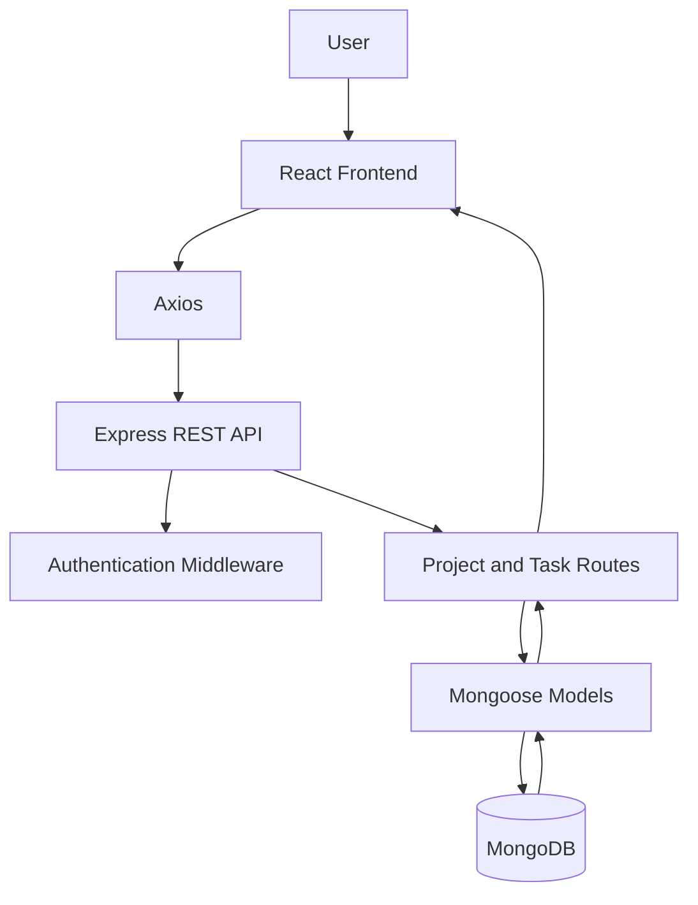
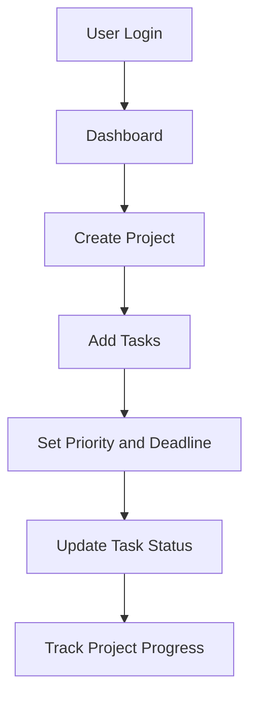

# TaskMaster – Project Management Application


## Overview

TaskMaster is a full-stack project and task management application designed to help users organize their daily activities, manage projects, track task progress, and improve productivity.

The application provides an interactive interface for creating projects, assigning tasks, setting deadlines, updating task statuses, and monitoring progress.

The frontend is developed using React.js, while Node.js and Express.js handle backend operations. MongoDB is used to store project, task, and user information.

## Key Features

### User Management
- User registration and login.
- Secure password handling.
- User-specific project and task management.
- Authentication for protected operations.

### Project Management
- Create new projects.
- View available projects.
- Update project information.
- Delete projects.
- Organize tasks under individual projects.

### Task Management
- Create and manage tasks.
- Add task descriptions.
- Set task deadlines.
- Assign task priorities.
- Update task status.
- View pending and completed tasks.
- Filter tasks based on status and priority.

### Dashboard
- Display project information.
- View total tasks.
- Track completed and pending tasks.
- Monitor overall project progress.
- Provide a centralized view of activities.

## Technology Stack

| Category | Technologies |
|---|---|
| Frontend | React.js |
| Programming Language | JavaScript |
| Backend | Node.js, Express.js |
| Database | MongoDB |
| ODM | Mongoose |
| API Communication | Axios |
| Routing | React Router |
| Authentication | JWT |
| Development Tools | VS Code, npm, Git |

## Application Architecture



## Project Structure

```text
TaskMaster/
│
├── frontend/
│   ├── public/
│   ├── src/
│   │   ├── components/
│   │   ├── pages/
│   │   ├── services/
│   │   ├── App.js
│   │   └── index.js
│   └── package.json
│
├── backend/
│   ├── config/
│   ├── controllers/
│   ├── middleware/
│   ├── models/
│   ├── routes/
│   ├── server.js
│   └── package.json
│
├── .gitignore
└── README.md
```

*Folder structure may vary depending on the final implementation.*

## Database Design

The application can use the following MongoDB collections.

### User Collection

| Field | Description |
|---|---|
| name | User name |
| email | User email |
| password | Hashed password |
| createdAt | Account creation date |

### Project Collection

| Field | Description |
|---|---|
| name | Project name |
| description | Project description |
| userId | Project owner |
| createdAt | Project creation date |

### Task Collection

| Field | Description |
|---|---|
| title | Task title |
| description | Task details |
| projectId | Associated project |
| userId | Associated user |
| priority | Task priority |
| status | Task completion status |
| dueDate | Task deadline |

## API Documentation

The following are expected API endpoints for this project. Update them to match the actual backend implementation.

### Authentication

| Method | Endpoint | Description |
|---|---|---|
| POST | `/api/auth/register` | Register a user |
| POST | `/api/auth/login` | Authenticate a user |

### Projects

| Method | Endpoint | Description |
|---|---|---|
| GET | `/api/projects` | Retrieve projects |
| POST | `/api/projects` | Create a project |
| GET | `/api/projects/:id` | Retrieve project details |
| PUT | `/api/projects/:id` | Update a project |
| DELETE | `/api/projects/:id` | Delete a project |

### Tasks

| Method | Endpoint | Description |
|---|---|---|
| GET | `/api/tasks` | Retrieve tasks |
| POST | `/api/tasks` | Create a task |
| GET | `/api/tasks/:id` | Retrieve task details |
| PUT | `/api/tasks/:id` | Update a task |
| DELETE | `/api/tasks/:id` | Delete a task |

## Task Management Workflow



## Installation and Setup

### Prerequisites

- Node.js
- npm
- MongoDB
- Git
- Visual Studio Code

### 1. Clone the Repository

```bash
git clone https://github.com/YOUR-USERNAME/TaskMaster.git
cd TaskMaster
```

### 2. Install Backend Dependencies

```bash
cd backend
npm install
```

### 3. Configure Environment Variables

Create a `.env` file inside the backend folder.

```env
PORT=5000
MONGODB_URI=mongodb://localhost:27017/taskmaster
JWT_SECRET=your_secret_key
```

### 4. Start the Backend

```bash
npm start
```

### 5. Install Frontend Dependencies

Open another terminal:

```bash
cd frontend
npm install
```

### 6. Start the Frontend

```bash
npm start
```

Open the application in your browser using the local URL displayed by the frontend development server.

## Future Enhancements

- Team collaboration and task assignment.
- Real-time task updates.
- Email notifications for deadlines.
- Calendar integration.
- Task comments and attachments.
- Advanced project analytics.
- Responsive mobile interface.

## Skills Demonstrated

- React.js development
- JavaScript programming
- Node.js and Express.js
- REST API development
- MongoDB database integration
- CRUD operations
- Authentication and authorization
- Full-stack application development
- Frontend and backend integration

## Conclusion

TaskMaster demonstrates the development of a full-stack project management application using modern JavaScript technologies. It provides a practical example of building user-focused web applications with frontend development, backend APIs, and database integration.
